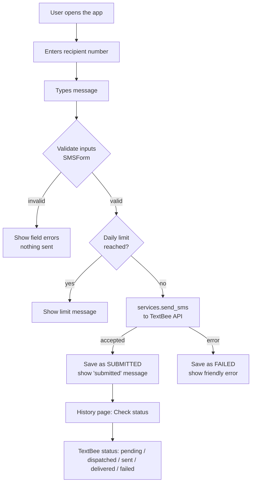

# SMS Sender - Django + TextBee

**IT 120 - Integrative Programming and Technologies - Laboratory/Assignment**

A Django web application that lets a user enter a recipient phone number and a message, validates both, sends the SMS through the TextBee API, and reports the result honestly (submitted vs. delivered). Every attempt is recorded in a history dashboard.

---

## 1. Project objectives

| | |
|---|---|
| **Purpose** | Demonstrate a complete Django request cycle that integrates an external SMS gateway API (TextBee) with validation, error handling, and secure credential management. |
| **Intended users** | A person who needs to send short SMS notifications to authorized test recipients from a browser and review previous sending attempts. |
| **SMS functionality** | Compose a message, validate it, submit it to TextBee, show success/failure feedback, store each attempt, and check TextBee's latest delivery status on demand. |

## 2. Author and responsibilities

*Individual submission*

| Author | Responsibility | Main files |
|---|---|---|
| **Dhant Guenryan G. Ranada** | Full implementation: Django project setup, models, views, URLs, UI/forms/validation, TextBee integration, automated & manual testing, and documentation | `sms_project/`, `sms_app/`, `requirements.txt`, `.env.example`, `README.md`, `docs/` |

## 3. Main features

**Required**
- SMS composition form: recipient number, message, and **Send SMS** button.
- Server-side validation (empty/invalid number, empty/too-long message) with clear error messages.
- TextBee integration through the official `textbee` Python package (`sms_app/services.py`).
- Error handling for missing number, empty message, invalid number format, missing or rejected API key (`401`/`403`), rate limits (`429`), network/connection failures (`OSError`), and unexpected provider errors.
- Django CSRF protection on every POST form; credentials loaded only from environment variables.

**Additional features**
- **Character counter** with GSM-7 vs. UCS-2 SMS-segment estimation.
- **Live message preview** (phone-style bubble using `textContent` to prevent XSS).
- **SMS message history + dashboard** showing aggregate counts (Attempts, Submitted, Delivered, Failed) and a paginated table of past attempts.
- **Message status tracking** — a **Check status** button fetches TextBee's latest status for a submitted batch.
- **Honest status reporting** — the app reports *"Submitted to TextBee"* when a request is accepted and only marks *"Delivered (confirmed by TextBee)"* once confirmed.
- Local Philippine mobile formats are normalized automatically (`0917 123 4567` becomes `+639171234567`).
- Daily send limit (`SMS_DAILY_LIMIT`) and masked recipient numbers in history.

## 4. SMS workflow



## 5. Project structure

```
project/
├── manage.py
├── requirements.txt        # Python dependencies (separate file)
├── .env.example            # placeholder values only
├── .gitignore
├── README.md
├── Testing.docx
├── docs/
│   └── CODE_WALKTHROUGH.md
├── sms_project/            # Django project package
│   ├── settings.py         # reads secrets from environment variables
│   ├── urls.py
│   └── wsgi.py / asgi.py
└── sms_app/                # the SMS application
    ├── models.py           # SMSMessage (history + status)
    ├── forms.py            # SMSForm + validation
    ├── phone.py            # phone-number normalisation (pure Python)
    ├── services.py         # ALL TextBee code + error translation
    ├── views.py            # send, history, refresh status
    ├── urls.py
    ├── admin.py
    ├── tests.py            # automated tests (TextBee mocked)
    ├── migrations/
    ├── templates/sms_app/  # base.html, send.html, history.html
    └── static/sms_app/     # css/style.css, js/send.js, js/theme.js
```

## 6. Technologies and dependencies

- **Python** 3.11+
- **Django** (`Django==5.2.19`) — web framework, ORM, forms, templates, CSRF & security middleware
- **TextBee Python SDK** (`textbee==0.3.0`) — SMS gateway integration
- **python-dotenv** (`python-dotenv==1.2.4`) — loads `.env` for local development
- **HTML, CSS, and vanilla JavaScript** — responsive UI, dark/light theme toggle, live counter, and preview
- **SQLite** — default Django database (`db.sqlite3`)

All Python dependencies are listed in [`requirements.txt`](requirements.txt).

## 7. Installation and setup

```bash
# 1. Clone the repository
git clone <your-repository-url>
cd project

# 2. Create and activate a virtual environment
python -m venv .venv
source .venv/bin/activate          # macOS / Linux
.venv\Scripts\activate             # Windows (PowerShell or CMD)

# 3. Install dependencies
pip install -r requirements.txt

# 4. Create your local configuration file
cp .env.example .env               # Windows: copy .env.example .env
```

Generate a Django secret key and put it in `.env`:

```bash
python -c "from django.core.management.utils import get_random_secret_key as g; print(g())"
```

Create the database tables:

```bash
# 5. Apply migrations
python manage.py migrate
```

## 8. Configuring the SMS provider (TextBee)

1. Create an account at <https://textbee.dev> and install/link the TextBee Android app on your phone as your SMS gateway device.
2. In your **TextBee** dashboard, generate/copy your **API Key**.
3. Copy `.env.example` to `.env` (never commit `.env` to GitHub) and fill in your values:

| Variable | Required | Description |
|---|---|---|
| `DJANGO_SECRET_KEY` | yes | Long random string for Django. |
| `DJANGO_DEBUG` | no | `True` for local development. Defaults to `False`. |
| `DJANGO_ALLOWED_HOSTS` | no | Comma-separated hosts. Default `localhost,127.0.0.1`. |
| `TEXTBEE_API_KEY` | yes | Your TextBee API key (keep secret). |
| `SMS_DEFAULT_COUNTRY_CODE` | no | Default `63` (Philippines). |
| `SMS_MAX_LENGTH` | no | Default `480` characters. |
| `SMS_DAILY_LIMIT` | no | Default `20` submissions per day. |

> Keep the linked Android phone powered on and connected to the internet when sending real test messages through TextBee.

## 9. Running the application

```bash
python manage.py runserver
```

- Open <http://127.0.0.1:8000/> to compose and send an SMS.
- Open <http://127.0.0.1:8000/history/> to view the sending dashboard and check delivery status.
- Optional admin interface: run `python manage.py createsuperuser`, then visit <http://127.0.0.1:8000/admin/>.

## 10. Testing procedures and results

### Automated tests (TextBee mocked)

Automated unit and view tests mock `sms_app.services.Textbee`, so running them sends no real SMS and uses no quota:

```bash
python manage.py test
```

**Automated test result:** `Ran 29 tests in 0.530s — OK` (`python manage.py check`: 0 issues).
Covered areas in `sms_app/tests.py`:
- Phone-number normalization (`0917...`, `+63...`, `0063...`, international E.164, invalid formats)
- `SMSForm` validation (empty recipient, empty/whitespace message, invalid phone, length over `SMS_MAX_LENGTH`)
- `send_view` (GET rendering, CSRF token presence, valid submission, missing credentials, 401 secret non-leakage, network error, 429 rate-limit, 500 provider error, unexpected exception containment, `SMS_DAILY_LIMIT`, input preservation on failure)
- `history_view` and `refresh_status_view` (recipient masking, empty state, status updates to `delivered`, empty batch data, network errors, `@require_POST` enforcement)

### Manual testing procedures and cases

Follow these steps to verify end-to-end behavior (also documented in [`Testing.docx`](Testing.docx)):

#### Test 1: Empty Phone Number & Message Validation (`Frontend / Form Validation`)
- **Action:** Leave both **Recipient phone number** and **Message** blank, then click **Send SMS**.
- **Expected Result:** Submission is blocked and validation errors are shown (*"Please enter the recipient's phone number."* and *"Please type a message to send."*). Nothing is sent to TextBee.

#### Test 2: Invalid Phone Number Format (`Input Validation`)
- **Action:** Enter `12345` in **Recipient phone number**, type `Hello world` in **Message**, and click **Send SMS**.
- **Expected Result:** The validator rejects the invalid number and displays a format error (*"Philippine mobile numbers look like 09171234567 or +639171234567."*).

#### Test 3: Valid SMS Submission & Delivery Status (`End-to-End Gateway Test`)
- **Action:** Enter an authorized test number (e.g., `0917...` or `+639...`), type a short test message such as `"IT 120 Test SMS"`, and click **Send SMS** while the TextBee Android device is online. Then open **History** and click **Check status**.
- **Expected Result:** The app submits to TextBee, shows *"Submitted to TextBee ... This confirms the request was accepted, not that the phone received it."*, logs the attempt in **History** with a masked recipient, receives the SMS on the authorized phone, and updates the status when **Check status** is clicked.

#### Test 4: Incorrect Credentials / Network Error Handling (`Error Resilience`)
- **Action:** Temporarily set `TEXTBEE_API_KEY` in `.env` to an invalid value (or disconnect the internet), restart `python manage.py runserver`, and submit a valid form.
- **Expected Result:** The app catches the `401`/`403` rejection or `OSError` cleanly, saves the attempt as `Failed`, and shows a friendly banner (*"TextBee rejected the API key..."* or *"Could not reach TextBee..."*) without crashing or exposing any API key. *(Restore your valid `TEXTBEE_API_KEY` in `.env` and restart the server afterward.)*

## 11. Security notes

- Credentials live only in environment variables / `.env`; `.env` is excluded via `.gitignore`, and `.env.example` contains placeholders only.
- Django `CsrfViewMiddleware` and `` protect all POST forms.
- `SecurityMiddleware`, `XFrameOptionsMiddleware` (`X_FRAME_OPTIONS = "DENY"`), `SESSION_COOKIE_HTTPONLY = True`, and `SECURE_CONTENT_TYPE_NOSNIFF = True` are enabled.
- Provider errors are translated into safe user-facing messages; API keys are never logged or displayed.
- The live browser preview uses `textContent` (not `innerHTML`), and Django templates auto-escape output.
- History views mask recipient phone numbers (`masked_recipient`).
- Only send SMS messages to authorized test recipients and follow TextBee's usage policies.

## 12. Known limitations

- **No user authentication:** Anyone who can reach the local server can send messages or view history. Run it locally for demonstration purposes (`SMS_DAILY_LIMIT` helps prevent accidental overuse); add authentication before any public deployment.
- **On-demand status polling:** Delivery status is updated when clicking **Check status** on the History page; there is no incoming webhook endpoint.
- **Gateway device dependency:** Because TextBee routes SMS through a linked Android device, that device must stay powered on, connected to the internet, and have mobile load/SMS capability.
- **Carrier delivery:** Acceptance by TextBee (`submitted`) does not guarantee carrier/handset delivery, which is why the UI separates *submitted* from *delivered*.
- **Segment counter:** The GSM-7 / UCS-2 segment count in the UI is an estimate.
- **No contact management:** Recipients are entered manually each time (message history only).
